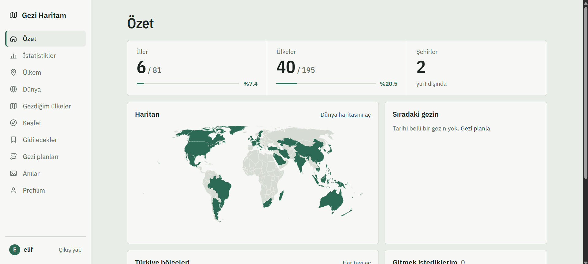
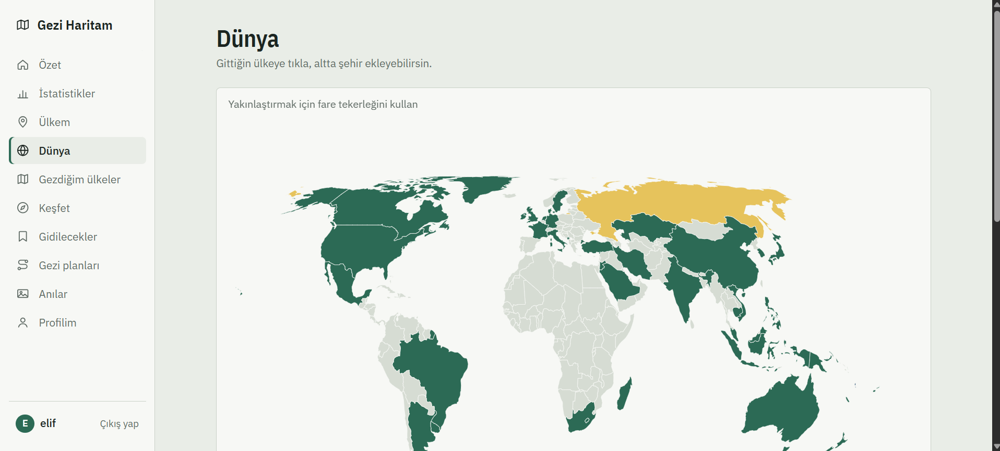
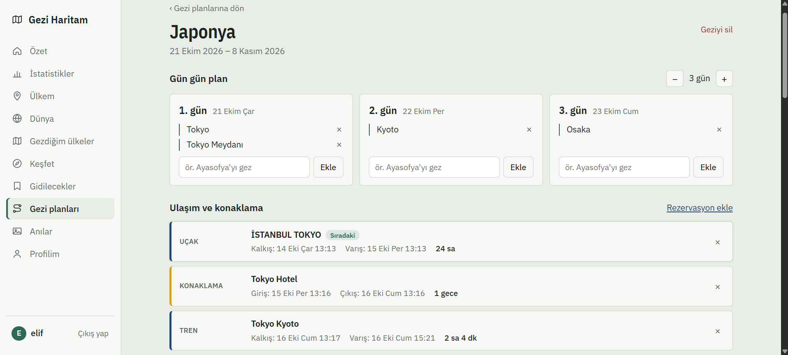
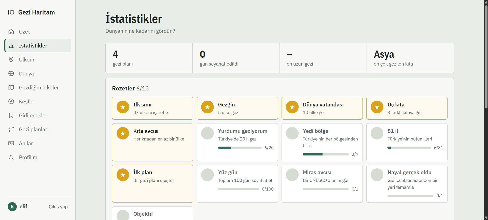
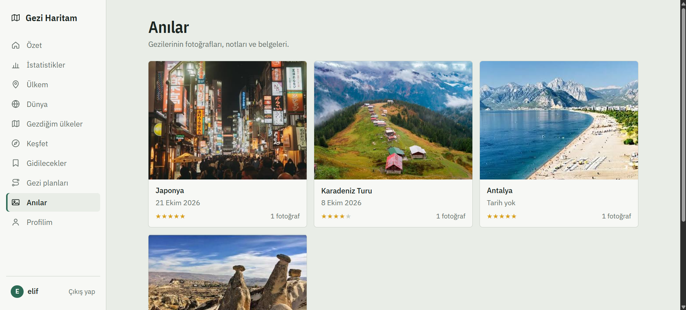

# 🗺️ Gezi Haritam — Travel Tracker


Türkiye'de ve dünyada gezdiğin yerleri harita üzerinde işaretleyebildiğin, gezilerini gün gün planlayıp bütçesini takip edebildiğin ve anılarını saklayabildiğin bir seyahat uygulaması.

**ASP.NET Core 8 Web API + Dapper + SQL Server** ile yazılmış bir backend ve **React (Vite)** ile yazılmış bir frontend'den oluşur.



## Özellikler

**Haritalar**
- Türkiye il haritası: gittiğin illeri işaretle, 7 coğrafi bölgeye göre ilerlemeni gör
- Dünya haritası: gittiğin ülkeler yeşil, gitmek istediklerin sarı
- Diğer ülkelerin il/eyalet haritaları (geoBoundaries verisiyle)
- Ülke bilgi kartı: başkent, para birimi ve güncel kur, diller, nüfus, komşular

**Gezi planlama**
- Gün gün plan: her güne yapılacaklar ekle
- Rota haritası: durakları sıralayıp haritada çizgiyle gör
- Ulaşım ve konaklama: uçuş, tren, otel bilgileri; süre ve PNR
- Bütçe ve harcamalar: kategorilere göre harcama, kişi başı maliyet, döviz dönüşümü

**Keşfet ve listeler**
- Dünyanın Yeni 7 Harikası, Türkiye'de görülmesi gerekenler, doğa harikaları
- 1.273 UNESCO Dünya Mirası alanı
- "Gidilecekler" listesi: öncelik, mevsim, tahmini bütçe

**Anılar ve istatistikler**
- Gezilere puan verme, gezi günlüğü, fotoğraf ve belge yükleme
- Kıtalara göre ilerleme, yıllara göre gezi grafiği, 13 rozet

**Hesap**
- JWT ile giriş/kayıt, şifreler BCrypt ile saklanır
- Profil düzenleme, kullanıcı adı ve şifre değiştirme

## Ekran görüntüleri

| Dünya | Gezi planı |
|---|---|
|  |  |

| İstatistikler | Anılar |
|---|---|
|  |  |

## Kullanılan teknolojiler

| Katman | Teknoloji |
|---|---|
| Backend | ASP.NET Core 8 Web API, Dapper, JWT Bearer, BCrypt.Net |
| Veritabanı | SQL Server (Express) |
| Frontend | React 18, Vite, react-simple-maps, d3-geo, lottie-react |
| Mimari | Repository deseni, Dependency Injection, katmanlı yapı (Controller → Repository → Model) |

## Proje yapısı

```
TravelTracker/
├── backend/          ASP.NET Core Web API
│   ├── Controllers/  API uç noktaları
│   ├── Repositories/ SQL sorguları (Dapper)
│   ├── Models/       Veri modelleri
│   └── Services/     JWT token üretimi
├── frontend/         React uygulaması
│   └── src/
│       ├── pages/       Sayfalar (menüdeki her öğe)
│       └── components/  Sayfa parçaları (haritalar, kartlar, formlar)
└── database/         Sırayla çalıştırılacak SQL script'leri (01–16)
```

## Kurulum

### Gereksinimler
- [.NET 8 SDK](https://dotnet.microsoft.com/download)
- [Node.js](https://nodejs.org/) 18 veya üzeri
- SQL Server (Express yeterli) ve SQL Server Management Studio

### 1. Veritabanı
SSMS'te `TravelTrackerDb` adında bir veritabanı oluştur, sonra `database/` klasöründeki script'leri **numara sırasıyla** (01'den 16'ya) çalıştır.

### 2. Backend
`backend/appsettings.json` içindeki bağlantı cümlesini kendi SQL Server adına göre düzenle:
```json
"ConnectionStrings": {
  "Default": "Server=localhost\\SQLEXPRESS;Database=TravelTrackerDb;Trusted_Connection=True;TrustServerCertificate=True;"
}
```
Ardından:
```bash
cd backend
dotnet run -- --environment Development
```
API `http://localhost:5000` adresinde çalışır, Swagger arayüzü `http://localhost:5000/swagger` adresindedir.

### 3. Frontend
```bash
cd frontend
npm install
npm run dev
```
Uygulama `http://localhost:5180` adresinde açılır. İlk açılışta **Kayıt ol** sekmesinden bir hesap oluştur.

### 4. Testler
```bash
dotnet test tests/TravelTracker.Tests
```

## Veri kaynakları

| Veri | Kaynak | Lisans |
|---|---|---|
| Dünya şehirleri | [GeoNames](https://www.geonames.org/) (all-the-cities paketi) | CC BY 4.0 |
| UNESCO alanları | [UNESCO Dünya Mirası Listesi](https://whc.unesco.org/en/list/) | — |
| Resim ve açıklamalar | [Wikipedia](https://www.wikipedia.org/) | CC BY-SA 4.0 |
| Ülke bölge sınırları | [geoBoundaries](https://www.geoboundaries.org/) | CC BY 4.0 |
| Ülke bilgileri | [world-countries](https://github.com/mledoze/countries) | ODbL |
| Döviz kurları | [Frankfurter](https://frankfurter.dev/) (Avrupa Merkez Bankası) | — |
| Nüfus | [Dünya Bankası](https://data.worldbank.org/) | CC BY 4.0 |
| Bayraklar | [flagcdn](https://flagcdn.com/) | — |

## Not
Bu proje öğrenme amacıyla geliştirilmiştir. `appsettings.json` içindeki JWT anahtarı sadece yerel geliştirme içindir; gerçek bir ortamda gizli tutulmalıdır (ör. `dotnet user-secrets` veya ortam değişkenleri).